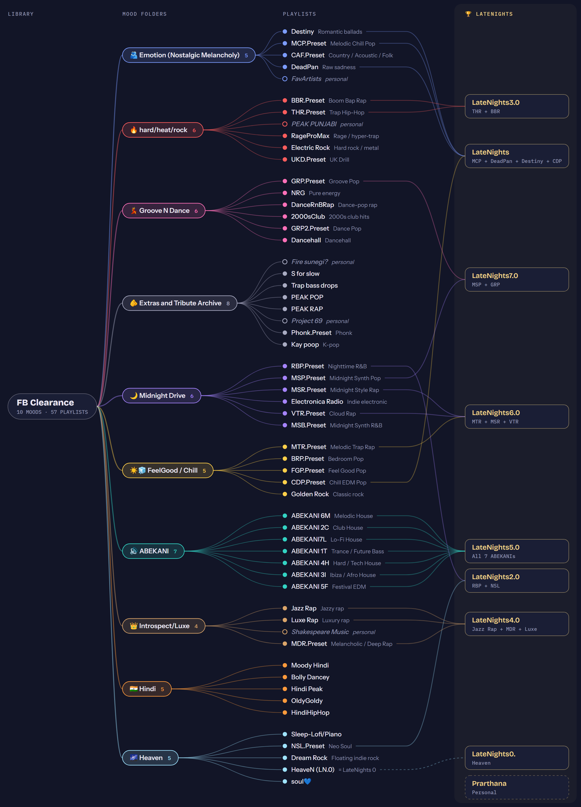

# spotiview

A visual map of my Spotify playlist system.

**Live:** https://anirudhs-playlist-view.netlify.app

## What it shows

My library has two layers:

- **FB Clearance**: the mood library. There are 10 mood folders (Emotion, hard/heat/rock, Groove N Dance, Midnight Drive, FeelGood / Chill, Introspect/Luxe, Heaven, ABEKANI, Hindi, Extras) holding 57 playlists. Most playlists are a genre "preset" such as MTR (Melodic Trap Rap) or RBP (Nighttime R&B).
- **LateNights**: the best-of layer. Each LateNights playlist pulls the top songs from specific playlists. For example, LateNights6.0 = MTR + MSR + VTR.

The map runs left to right: library → mood folders → playlists → LateNights. Hover or tap any node to trace its connections. Search works on playlist names, codes and songs. "Not in LateNights" highlights the playlists that don't feed any LateNights yet.

The whole map fits the screen when it opens. Pinch (or Ctrl + scroll) to zoom, scroll with two fingers or drag to move, and press FIT (or 0) to see everything again. On a laptop, "Hide details" gives the map the full width and "Fullscreen" fills the screen. On a phone, tapping anything opens its details in a bottom sheet.

## Files

| File | What it is |
|---|---|
| `site/index.html` | The whole site in one file. The playlist data sits between the `YOUR PLAYLIST DATA` markers. |
| `playlist-map.png` | Static infographic of the full map. Regenerate it by opening `site/index.html#poster` and screenshotting the page at 2x. |
| `Spotify system (1).txt` | The original written taxonomy of each playlist code. It's older than the map: the map's data block is the up-to-date version. |

## Updating

1. Edit the data block in `site/index.html`.
2. Open it in a browser to check.
3. Drag `site/index.html` onto the site's **Deploys** page on Netlify.
